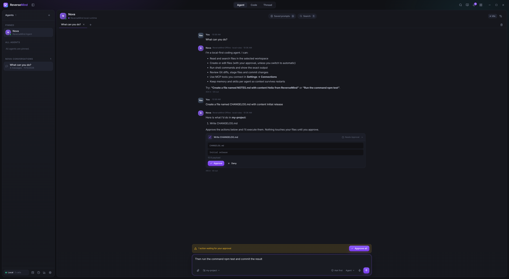

# ReverseMind

**A local-first agent workspace for Linux.** Coding agents, real terminals, an editor, Git review, an embedded browser, tickets, routines and MCP servers in one Electron app. No account, no hosted gateway, no telemetry.



## Features

- **Agents** with per-agent memory, skills and approval policy. Runs offline with built-in rules, or streams from any Anthropic or OpenAI-compatible endpoint with native tool use. The model sees each tool result and keeps going (15-round cap, Stop button).
- **Ask / Plan / Agent modes** enforced in the runtime, not just the UI. Every file write, command and commit is a reviewable card.
- **Code workspaces**: chat, real PTY terminals (they survive view switches), editor, files, Git (stage, diff, commit, worktrees) and browser panes.
- **MCP** stdio servers, reconnected on start, with per-server plugin gating. Launch Claude Code, Codex, Gemini CLI, Aider and others in a terminal pane.
- **Tickets, routines, prompt library and usage tracking**, all stored locally.
- **Hardened**: sandboxed renderer, workspace paths jailed against `..` and symlinks, locked-down browser pane, API keys in the OS keyring when available.

## Install

Download a package from the [latest release](https://github.com/GeneticxCln/ReverseMind/releases/latest):

| Format | Command |
| --- | --- |
| AppImage | `chmod +x ReverseMind-*.AppImage && ./ReverseMind-*.AppImage` |
| Debian / Ubuntu | `sudo apt install ./ReverseMind-*-amd64.deb` |
| Fedora / RHEL | `sudo dnf install ./ReverseMind-*.x86_64.rpm` |
| Arch / CachyOS | `sudo pacman -U ReverseMind-*-x86_64.pkg.tar.xz` |
| Any distro | `tar xzf ReverseMind-*-x64.tar.gz`, then run `reversemind` inside |

Builds are unsigned and need `python3` on the host for terminals.

## Build from source

Requires Linux, Node 20+, Python 3 (for terminals) and Git.

```bash
npm install
npm run dev          # development
npm start            # production build
npm run package      # AppImage in release/
npm run package:all  # AppImage, deb, rpm, tar.gz, pacman (rpm needs rpmbuild)
```

Add a model under **Settings → Model providers**, or use the offline runtime with no setup.

## Testing

```bash
npm run typecheck
npm run test:e2e         # builds, then runs the Playwright suite (needs a display)
npm run test:packaged    # packages, then smoke-tests the unpacked app
```

## Status

Usable beta, version 0.1.0. Not yet done: signing and auto-update, MCP resources and prompts, Git pull/push, syntax highlighting in the editor, clean-machine install testing. See [docs/DETAILS.md](docs/DETAILS.md) for architecture, the security model, the full status table and known gaps.

## License

MIT, see [LICENSE](LICENSE).
